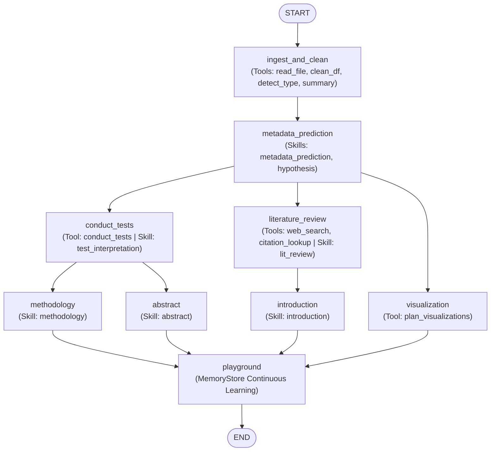

# Research Agent (`research_agent`)

An isolated, modular research assistant agent designed around modern agentic AI patterns:
* **LangGraph StateGraph Workflow**: The agent travels through dedicated states mirroring the platform's original workflow states (`test_status`, `literature_review_status`, `abstract_status`, `introduction_status`, `methodology_status`, `visualization_status`, `playground_status`), with each state having its own dedicated tools.
* **Tools (not functions)**: Self-describing, schema-validated execution primitives (`BaseTool` -> `ToolResult`).
* **Skills (not static rules)**: Higher-order workflows that combine prompts, fallback chains, and tools with continuous learning (`BaseSkill`).
* **Continuous Learner (not isolated context)**: Two-tiered memory:
  - `SessionContext`: Working memory, tool history, and intermediate skill outputs.
  - `MemoryStore`: Persistent memory that learns column-type mappings, test significance outcomes, prompt success patterns, and user overrides across sessions.
* **Provider-Agnostic LLM Engine**: Unified fallback chain supporting Mistral, Google Gemini, and OpenAI without hardcoded providers or keys.

## Statistical and manuscript validation boundaries

The default workflow retains outliers and records missing-data exclusions separately.
A non-significant result does not trigger alternative cleaning or a new hypothesis.
Explicit LATS runs are exploratory cleaning-sensitivity analyses: the analysis hypothesis
is held fixed, scores do not reward small p-values, and multiplicity counts every
reported test across the explored paths. They do not replace a prespecified analysis.

The structured `StudyFacts` manuscript contract currently supports categorical-group,
numeric-outcome cross-sectional analyses. Other designs may run through the statistical
dispatcher but do not receive fabricated ANOVA/regression facts. Missing facts, missing
authors, validation errors, or failed graph manuscript reviews produce a clearly marked
draft. Automated validation is not independent scientific peer review. Investigators
must supply author identities, data/code availability details, and verify interpretations.

Dataset queries accept a limited dataframe summary-expression language, not arbitrary
Python. Generated papers use separate temporary output directories by default.

Offline regression suite (run from the backend directory):
```powershell
.\venv\Scripts\python.exe -B -m pytest research_agent/tests --ignore=research_agent/tests/test_api_endpoint.py -q -p no:cacheprovider
```
This suite isolates provider credentials and searches. Live provider/API integration and
real TeX installations require separate integration checks.

---

## StateGraph Architecture & State-Tool Bindings

The agent execution is governed by a compiled LangGraph `StateGraph` that transitions through states adhering to original system dependencies:



### State-to-Tool Matrix

| State Name | Original Workflow State | Tools & Skills Bound to State |
|---|---|---|
| `ingest_and_clean` | Data Ingestion & Cleaning | Tools: `read_file`, `clean_dataframe`, `detect_variable_type`, `produce_variable_summary` |
| `metadata_prediction` | Pre-analysis Inference | Skills: `metadata_prediction`, `hypothesis` |
| `conduct_tests` | `test_status` | Tool: `conduct_tests` \| Skill: `test_interpretation` |
| `literature_review` | `literature_review_status` | Tools: `duckduckgo_search`, `citation_lookup` \| Skill: `literature_review` |
| `introduction` | `introduction_status` | Skill: `introduction` (uses `literature_review` outputs) |
| `methodology` | `methodology_status` | Skill: `methodology` (uses test names & dataset metrics) |
| `abstract` | `abstract_status` | Skill: `abstract` (uses `test_interpretation` & sample size) |
| `visualization` | `visualization_status` | Tool: `plan_visualizations` (Pydantic schema-enforced) |
| `playground` | `playground_status` | Memory: `MemoryStore` continuous learning updates |

---

## Architecture Overview

```
research_agent/
├── agent.py                    # ResearchAgent - master orchestrator & run_graph entrypoint
├── config.py                   # Multi-provider configuration & model fallback registry
├── schemas.py                  # Pydantic data exchange models
├── requirements.txt            # Package dependencies
├── bridge.py                   # Backward-compatibility shims for existing backend routers
├── graph/                      # LangGraph StateGraph Architecture
│   ├── state.py                # ResearchGraphState schema with Annotated reducers
│   ├── nodes.py                # State Node implementations with state-tool bindings
│   └── graph.py                # StateGraph compilation & edge routing
├── memory/
│   ├── context.py              # Working session memory
│   └── store.py                # Persistent cross-session continuous learning
├── tools/
│   ├── base.py                 # BaseTool and ToolResult abstractions
│   ├── data_tools.py           # ReadFile, CleanDataFrame, DetectType, Summary
│   ├── search_tools.py         # WebSearch, CitationLookup (Crossref)
│   ├── statistics_tools.py     # Statistical test execution & introspection
│   ├── visualization_tools.py  # Pydantic schema-constrained plotting planner
│   └── latex_paper_tool.py     # Academic paper LaTeX creator with journal templates
├── latex_templates/            # Journal LaTeX template suite & compiler
│   ├── manager.py              # Template rendering, bundle creation & PDF compiler
│   ├── downloader.py           # Remote template fetcher (CTAN, GitHub, Overleaf)
│   ├── formatter.py            # Markdown-to-LaTeX, BibTeX generator & booktabs tables
│   └── templates/              # Journal templates (IEEE, Elsevier, Nature, ACM, PLOS, arXiv)
├── skills/
│   ├── base.py                 # BaseSkill abstraction with fallback LLM caller
│   ├── hypothesis.py           # Hypothesis generation
│   ├── abstract.py             # Academic abstract generation
│   ├── methodology.py          # Methodology section synthesis
│   ├── introduction.py         # Introduction synthesis with literature context
│   ├── literature_review.py    # Autonomous search & citation agent
│   ├── metadata_prediction.py  # Structural metadata (IV, DV, design) predictor
│   ├── test_interpretation.py  # Statistical significance interpreter
│   └── confounding_variables.py# Confounding variables discovery
├── prompts/
│   └── templates.py            # Externalized, parameterized prompt templates
├── study_designs/
│   ├── dispatcher.py           # Pure statistical dispatch logic
│   └── ...                     # Statistical test suites (RCT, Pre-post, Cohort, etc.)
└── tests/
    ├── test_graph.py           # StateGraph state-transition tests
    ├── test_agent.py           # Agent orchestration tests
    ├── test_memory.py          # Continuous learning tests
    └── test_tools.py           # Tool execution tests
```

---

## Quickstart (StateGraph Workflow)

```python
from research_agent import ResearchAgent, AgentConfig
from research_agent.schemas import ResearchContext

# 1. Initialize agent
agent = ResearchAgent(AgentConfig(
    model_preference=["mistral-large", "gemini-flash"]
))

# 2. Define research context
context = ResearchContext(
    file_path="data.csv",
    problem_statement="Investigating how sleep quality impacts cognitive memory score."
)

# 3. Execute the StateGraph (travels from state to state)
final_state = agent.run_graph(context=context)

# 4. Access state outputs and statuses
print("Test Status:", final_state["test_status"])
print("Test Results:", final_state["test_results"])
print("Abstract:", final_state["abstract"])
print("Methodology:", final_state["methodology"])
print("Visualizations planned:", len(final_state["visualizations"]))

# 5. Create Publication-Ready Academic Paper using Journal Templates
paper_bundle = agent.create_paper(
    context=context,
    template="nature",  # "ieee", "elsevier", "nature", "acm", "plos", "generic_arxiv"
    output_dir="./paper_output",
    compile_pdf=True,
)
print("Paper TeX File:", paper_bundle["tex_file"])
print("BibTeX File:", paper_bundle["bib_file"])
```
